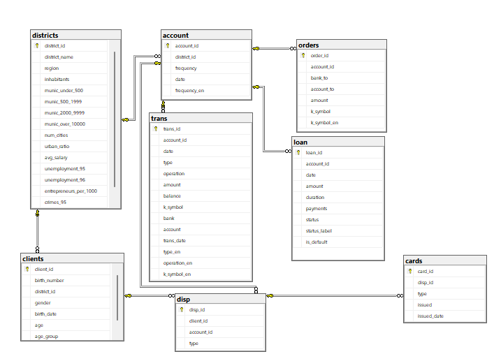

# Bank Loan & Customer Analytics (SQL Server)

An end-to-end SQL project on **real, anonymised banking data** from a Czech bank (the Berka dataset, PKDD'99).
I built the database from raw files, cleaned it, answered 12 business questions about customers, transactions and loan default, and prepared reporting views for Power BI.

**Tools:** SQL Server 2025, SSMS · **Skills:** JOINs, CTEs, subqueries, `EXISTS`, window functions (`ROW_NUMBER`, `LAG`, `SUM() OVER`), `CASE`, data cleaning, views

---

## Data

| Table | Rows | Description |
|---|---:|---|
| `trans` | 1,056,320 | Account transactions, 1993–1998 |
| `orders` | 6,471 | Standing payment orders |
| `clients` | 5,369 | Clients (gender and birth date hidden inside `birth_number`) |
| `disp` | 5,369 | Links clients to accounts (owner / user) |
| `account` | 4,500 | Accounts and their branch district |
| `cards` | 892 | Credit cards (junior / classic / gold) |
| `loan` | 682 | Loans and their status (A / B / C / D) |
| `districts` | 77 | Demographics: region, average salary, unemployment |

Amounts are in Czech koruna (CZK).

## Database diagram



---

## Process

| Step | File | What I did |
|---|---|---|
| **A. Build** | `01_setup.sql` | Created the database, loaded 8 CSV files (1M+ rows with `BULK INSERT`), added 8 primary keys and 8 foreign keys |
| **B. Clean** | `02_cleaning.sql` | Converted `YYMMDD` numbers to dates · extracted gender, birth date, age and age group from `birth_number` (women's month is +50) · translated Czech codes to English · added a loan `status_label` and `is_default` flag · gave the 16 district columns readable names |
| **C. Analyse** | `03_analysis.sql` | 12 business questions, each followed by a written finding |
| **D. Report** | `04_views.sql` | 3 views for Power BI: `vw_loan_summary`, `vw_monthly_transactions`, `vw_client_profile` |

### Data quality issues found while cleaning
- `trans.type` has an undocumented value `VYBER` (16,666 rows), treated as a withdrawal.
- `trans.operation` is empty for 183,114 rows; these match exactly the interest postings (`k_symbol = 'UROK'`).
- `k_symbol` has two kinds of "empty": `NULL` and a single space `' '`. Both were mapped to `Other`.
- `districts` has `?` for two missing values (unemployment 1995, crimes 1995), stored as `NULL`.
- 2,999 transactions leave a negative balance (overdrafts).

---

## Key findings

| # | Question | Finding |
|---|---|---|
| C3 | How many loans default? | **11.1%** of loans (76 of 682) are in default, but they are much larger on average, so they make up **15.1% of the loan amount** |
| C4 | Which regions are riskiest? | **West Bohemia 15.8%**, North Moravia 15.4% (most defaults: 18), South Bohemia 15.0% vs bank average 11.1% |
| C5 | Does loan duration matter? | 12-month loans default least (**8.4%**); from 24 months up the rate is flat (11.5%–12.3%) |
| C6 | Do card holders default less? | **2.9%** with a card vs **13.9%** without, almost **5x lower** |
| C7 | Does district salary matter? | Low-salary districts are highest (12.3%), but the link is weak (medium 9.6%, high 10.2%) |
| C8 | How did activity change in 1998? | Stable at ~25,000 transactions/month; January is an outlier (42,940) |
| C10 | How do clients use the bank? | Cash withdrawals are **41.2%** of all transactions; card withdrawals only **0.8%** |
| C11 | Do overdrafts predict default? | **100%** of loans on accounts that went negative defaulted vs **0%** of the rest |
| C2 / C12 | Who are the clients? | Gender-balanced, but older: **40% are 50+**, 24% under 30. Default rates are similar across ages (10.3%–12.8%) |

> **A note on C11:** a perfect 100% vs 0% split is a warning sign. The negative balance is most likely a *result* of default (automatic loan instalments push the account below zero), not a cause. It should not be used as a predictive feature (data leakage), but it works very well as an **early-warning trigger**.

---

## Recommendations

**1. Early-warning alert for negative balances**
- **Observation:** Every borrower whose account went below zero ended up in default.
- **Number:** 76 of 76 loans (100%) vs 0 of 606 (0%) for accounts that never went negative (C11).
- **Action:** Create an automatic alert when any account with an active loan goes negative, so the collections team contacts the client within 48 hours and offers a restructuring plan before the loan becomes non-performing.

**2. Use card ownership in loan approval**
- **Observation:** Borrowers without a card default far more than card holders, yet card usage is very low.
- **Number:** 13.9% default rate without a card vs 2.9% with a card (almost 5x) (C6); card withdrawals are only 0.8% of all transactions (C10).
- **Action:** Tighten requirements for applicants who have no card and no regular account activity (extra income verification or a lower loan limit), and add card ownership as a positive factor in the credit score. In parallel, promote cards to existing clients to increase usage and build the payment history the bank needs to assess risk.

**3. Grow the under-30 customer base**
- **Observation:** The client base is ageing: clients aged 50+ outnumber clients under 30 by about 1.7 to 1.
- **Number:** 2,163 clients aged 50+ (40%) vs 1,282 under 30 (24%) (C2). Under-30 borrowers default at 11.0%, in line with the bank average of 11.1%, so they are not a higher-risk group (C12).
- **Action:** Launch a youth package (no-fee starter account with a debit card and a mobile app) aimed at students and first-job employees, and track the share of new accounts opened by under-30 clients every quarter. This builds the future loan pipeline as older clients leave.

---

## How to run

1. Install **SQL Server** (Developer edition, free) and **SSMS**.
2. Download the Berka dataset and save the 8 CSV files to `C:\Berka\`
   (`account.csv`, `card.csv`, `client.csv`, `disp.csv`, `district.csv`, `loan.csv`, `order.csv`, `trans.csv`).
3. Run the scripts in order: `01_setup.sql` → `02_cleaning.sql` → `03_analysis.sql` → `04_views.sql`.

## Repository structure

```
├── 01_setup.sql       # Database, tables, data load, keys
├── 02_cleaning.sql    # Dates, client attributes, code translation, loan flags
├── 03_analysis.sql    # 12 business questions with findings
├── 04_views.sql       # Reporting views for Power BI
├── erd.png            # Database diagram
└── README.md
```

## Next step

Connect Power BI to the three views and build an interactive loan-risk dashboard.

## Data source

Berka, P. *Guide to the Financial Data Set*. PKDD'99 Discovery Challenge, Prague, 1999.

---

**Abdulrahman Lehlouh** · Data Science & AI graduate · Kuwait
